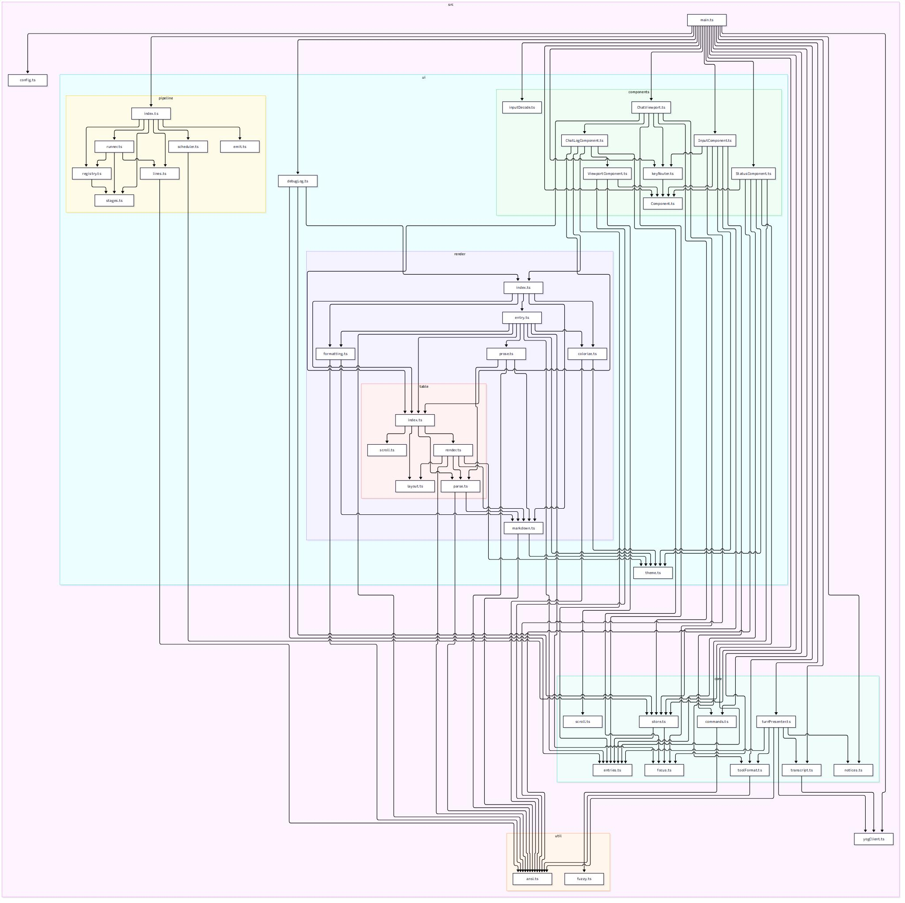

# yog-client-tui

A minimal terminal chat client for yog-style HTTP/SSE servers, built with Node.js
and TypeScript. It opens a session, streams assistant replies into a scrollable log
viewport, and resumes where it left off: the server owns the canonical transcript,
so turns send only the new prompt and a relaunch rehydrates the whole conversation
from the server before the first prompt. Terminal styling is
provided by `@oakoliver/lipgloss` (a TypeScript port of charmbracelet/lipgloss)
with `@oakoliver/glamour` markdown rendering.

## Architecture

<details><summary>Dependency graph</summary>
<br />


</details>

The code is split into responsibility domains with enforced dependency rules
(dependency-cruiser checks them in `npm run depcruise`):

| Domain           | Location           | Responsibility                                                                                                                                                                                                                                                                                                                                                                           |
| ---------------- | ------------------ | ---------------------------------------------------------------------------------------------------------------------------------------------------------------------------------------------------------------------------------------------------------------------------------------------------------------------------------------------------------------------------------------- |
| Composition root | `src/main.ts`      | Wiring only: config loading, terminal lifecycle, key routing, render scheduling. The only module allowed to import `config/`.                                                                                                                                                                                                                                                            |
| `config`         | `src/config.ts`    | Config parsing and validation: `model` and `baseUrl` (both required); config/state file locations resolved from `XDG_CONFIG_HOME` → `HOME` → `PWD`. |
| `core`           | `src/core/`        | The domain: the log-entry shape (`core/entries`), the tiny state store (`getState` / `setState` / `subscribe`), the focus ring (`core/focus`), scroll math, tool-argument/result formatting (`core/toolFormat`), transcript conversion (server rows → display entries, `core/transcript`), and the turn presenter (SSE events → state, no rendering). Never imports the presentation layer. |
| `client`         | `src/yogClient.ts` | The yog HTTP/SSE transport: capabilities probe → resume-or-create `POST /v1/sessions` → prompt-only `POST /v1/sessions/{id}/turns` with `{prompt, model}` → SSE event consumption → turn-status recovery → transcript rehydration (`GET /v1/sessions/{id}/transcript`). Sessions outlive the client: quit never deletes. Never touches the terminal, styling, config, or the filesystem. |
| `ui`             | `src/ui/`          | Components (`ui/components`: base contract, chat log/viewport, input bar, status line, focus-scoped key router), presentation (`ui/render`: entry rendering, the table engine — parse / layout / render / scroll, the memoized row cache), and the single theme source (`ui/theme.ts`). Talks to the store, never to the transport or filesystem. |
| `util`           | `src/util/`        | ANSI width / wrap / truncate helpers. A leaf domain: imports nothing from any other domain.                                                                                                                                                                                                                                                                                              |
| `ui/pipeline`    | `src/ui/pipeline/` | The render pipeline: fixed stage runner, per-stage hook registry, store-backed frame scheduler, and the single frame writer.                                                                                                                                                                                                                                                             |

`client/` never touches the terminal and `ui/` never touches the transport, so
presentation can change without affecting transport logic (and vice versa).

### Render pipeline

Every redraw runs through a fixed sequence of stages — the order is data (the
`STAGES` array), not convention, so it is deterministic by construction:

| Stage     | Core work                                                                                  | Hook point                                          |
| --------- | ------------------------------------------------------------------------------------------ | --------------------------------------------------- |
| `layout`  | Measure terminal geometry (cols/rows/viewport rows) into components.                       | —                                                   |
| `paint`   | Each component renders its rows.                                                           | components + overlays that draw into the paint pass |
| `compose` | Pass-through — paint already joined the rows; compose hooks rewrite the frame. | —                                                   |
| `post`    | Pad/truncate every ANSI line to the terminal width.                                        | overlays, status widgets, banners                   |
| `emit`    | Write the finished frame to stdout — a single owner (`writeFrame`); nothing runs after it. | —                                                   |

Features extend the pipeline with `register(stage, hook)` from
`src/ui/pipeline/index.ts`: hooks append to an ordered array per stage and run
after that stage's core work, each receiving and returning the current frame so
later hooks always see earlier hooks' output. Ordering is registration order —
no priority numbers to reason about — and `register` returns an unregister
function. An empty hook list means the pipeline is exactly the core stages, so
hook-free rendering is byte-identical frame for frame.

Frame coalescing lives in the pipeline too: the scheduler subscribes to the state
store once, collapses bursts of `setState` into one flush per `FRAME_MS` window,
and the flush runs the stages.

## Setup

```sh
npm install
# Copy the template into one of the locations from Configuration below
# ($XDG_CONFIG_HOME → $HOME → PWD); for example:
mkdir -p ~/.config/yog-client-tui
cp config.example.json ~/.config/yog-client-tui/config.json
# edit config.json and set your model id
npm start
```

`npm start` runs `node src/main.ts` directly (Node 22+ type-stripping; no build
step). `npm run typecheck` runs `tsc --noEmit`.

## Configuration

The client looks for `config.json` in the first existing location of:

- `$XDG_CONFIG_HOME/yog-client-tui/config.json` (when `XDG_CONFIG_HOME` is set)
- `$HOME/.yog-client-tui/config.json` (when `HOME` is set)
- `./yog-client-tui/config.json` (relative to the current working directory)

See `config.example.json` for the committed template — a real `config.json` is
git-ignored. Session state lives alongside it in `state.json`.

| Key       | Required | Description                                                            |
| --------- | -------- | ---------------------------------------------------------------------- |
| `model`   | yes      | Model id sent with every turn.                                         |
| `baseUrl` | yes      | Server base URL (e.g. `http://127.0.0.1:8111` for a local daemon).     |

The session to resume comes from `--session <id>` (CLI), else the
`lastSessionId` persisted in `state.json`, else a fresh session; `--new`
forces a fresh one. If the config file is missing or malformed, the client
exits with an error.

## Key bindings

| Key                                               | Action                                                                           |
| ------------------------------------------------- | -------------------------------------------------------------------------------- |
| `Enter`                                           | Send the current input (on a focused chunk / tool call: expand/collapse it; on a focused table: expand/collapse its columns) |
| `Shift+Enter`                                   | Insert a newline in the input (without sending)                                   |
| `/quit`                                           | Quit via the slash command (`/` as the first input character, Tab completes)       |
| `←` / `→` / `↑` / `↓`, `Home` / `End`,          | Edit input; in a multi-line input ↑/↓ move the caret between lines (a single-line input leaves ↑/↓ to scroll the log) |
| `Backspace` / `Delete`                          | (on a focused expanded table: scroll columns horizontally)                        |
| `PageUp` / `PageDown`                           | Scroll the log viewport                                                          |
| `Ctrl+Home` / `Ctrl+End`                          | Jump to top / bottom of the log                                                  |
| `Tab`                                             | Focus the next expandable unit (tool call / output chunk / table; every table in a message is its own unit; wraps through "none") |
| `Shift+Tab`                                       | Focus the previous unit (wraps through "none")                                   |
| `Esc`                                             | Leave focus mode · abort the in-flight turn (idle → no-op)                       |

While a turn is in flight, Enter is ignored (one turn at a time); input editing
continues. The status line shows a spinner and key hints — including `Esc abort`
while busy.

Esc with a focused entry only leaves focus mode; with nothing focused it aborts
the active turn via the server's `POST /v1/sessions/{id}/abort` endpoint: the
server kills the tool call in flight, closes the model stream, heals the
transcript, and settles the turn, and the TUI logs a `⏹ turn aborted` line.

The input bar is a multi-line textarea: it grows and shrinks to fit its
content up to ten lines and scrolls vertically beyond that. `Enter` submits;
`Shift+Enter` inserts a line break. Pasted text (bracketed paste) is inserted
verbatim — including newlines — and never submits.

`Shift+Enter` is recognized from the CSI-u / Kitty (`ESC[13;2u`), xterm
modifyOtherKeys (`ESC[27;2;13~`), and `ESC[13;2~` encodings. If a terminal is
configured to not report modified keys, Shift+Enter is indistinguishable from
Enter. Set `YOG_DEBUG_KEYS=1` to hex-dump every input chunk to stderr while
debugging key handling.

### Debug mode

Set `YOG_DEBUG=1` to enable client-side debug chunks. Diagnostics emitted by
the client (currently: every input key/char/paste event) are appended to the
chat log as `🐞 debug` chunks — consecutive messages merge into one chunk until
a non-debug entry lands in the log. Debug chunks mirror tool-result chunks:
they are focusable, collapsed to five body lines by default, and expandable
with focus + Enter. They never leave the client (not sent to the server, not
part of the transcript).

### Slash commands

Type `/` as the **very first character** of the input line to open the
autocomplete menu; it stays closed for slashes anywhere else. `Tab` cycles
through and applies the highlighted match, `Enter` runs the completed command.
Commands run even while a turn is in flight.

| Command    | Action |
| ---------- | ------ |
| `/quit`    | Exit the client (formerly `Ctrl+C`): restores the terminal and leaves the session on the server so the next launch resumes it. `Ctrl+C` itself is now unbound / inert. |

### Tables

A message containing a GFM pipe table is focusable, and every table in the
message is its own focus target (`Tab` walks the tables before moving to
the next message). The focused table draws blue borders; the others stay
white.

The table engine reshapes a table in a fixed order (all widths in terminal
cells):

1. **Shrinkwrap** every column to its content width.
2. If the table fits the viewport that way, it is **done** — rendered
   as-is, and `Enter` does nothing (there is nothing to expand).
3. Otherwise the available space (viewport minus borders and padding) is
   divided **evenly** among the columns, never giving a column more than
   its content needs.
4. If every column either fits its content or was given at least 30
   cells, the table is **done** — rendered as-is, and `Enter` does nothing.
5. Otherwise the table is **expandable**. The current display is the
   collapsed one (it fits the viewport); `Enter` switches to the expanded
   one, where the squeezed columns are widened to at most 30 cells each.
   The expanded table may extend past the viewport — `←`/`→` (or `h`/`l`,
   `Home`/`End`) scroll it.

The 30-cell ceiling applies only to the expanded layout: a table that
fits the viewport when collapsed keeps its columns exactly as they are,
and a column wider than 30 cells is never shrunk below its own width.
Each table's expansion and scroll offset are tracked per table, so two
tables in one message expand and scroll independently.

## How it talks to yog

The server owns the canonical conversation. At startup the client:

1. Probes server capabilities and requires the `transcript` feature (a daemon
   without it is not running the current contract — the client exits with an
   error rather than compensating).
2. Resolves the session: `--session <id>` from the command line, else the
   stored `lastSessionId` in `state.json`, else a fresh session (`--new` forces a
   fresh one regardless). A resumable id is validated with
   `GET /v1/sessions/{id}`; a stale id (`unknown_session`) falls back to a
   fresh session with a one-line note.
3. Rehydrates the visible conversation from the server's transcript dump
   (`GET /v1/sessions/{id}/transcript`) — every message kind, full fidelity:
   tool calls render as the same rich, expandable entries a live turn
   produces, annotated with their results, before the first frame is drawn.
4. Persists the resolved session id into `state.json` so the next launch
   resumes automatically (a failed startup never overwrites the stored id).

On each turn the client then:

5. `POST /v1/sessions/{id}/turns` with `{ prompt, model }` only — the server
   hydrates prior context from its canonical transcript, so no history ever
   rides along (retries after a failed turn replay from the last turn
   boundary server-side).
6. Consumes the SSE stream, rendering deltas into the assistant entry, tool
   call lines with an inline ✅/❌ indicator and syntax-highlighted args,
   collapsible (Tab + Enter) result chunks for tool output, and error events
   as they arrive.
7. If the stream drops, recovers the turn outcome from the turn-status endpoint
   (a "stream interrupted — recovered from turn status" note is logged).
8. Esc (with nothing focused) aborts the active turn via
   `POST /v1/sessions/{id}/abort` — a `⏹ turn aborted` note is logged from
   the stream's terminal `turn.aborted` event.
9. On quit, keeps the session: the server's DELETE is a detach (status
   `open` → `dormant`) and the transcript is kept, so the next launch resumes
   where this one left off. Only a server-side purge (`DELETE ?purge=true`)
   or the 30-day retention prune truly ends a session.

The bundled `config.example.json` points at the local daemon `http://127.0.0.1:8111`.
